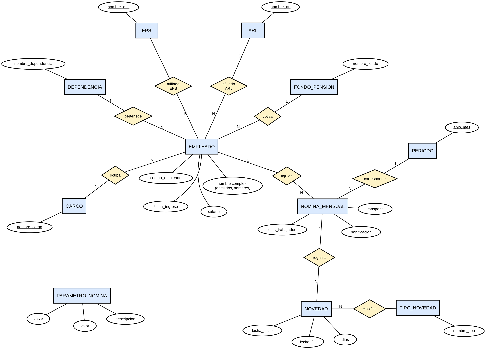
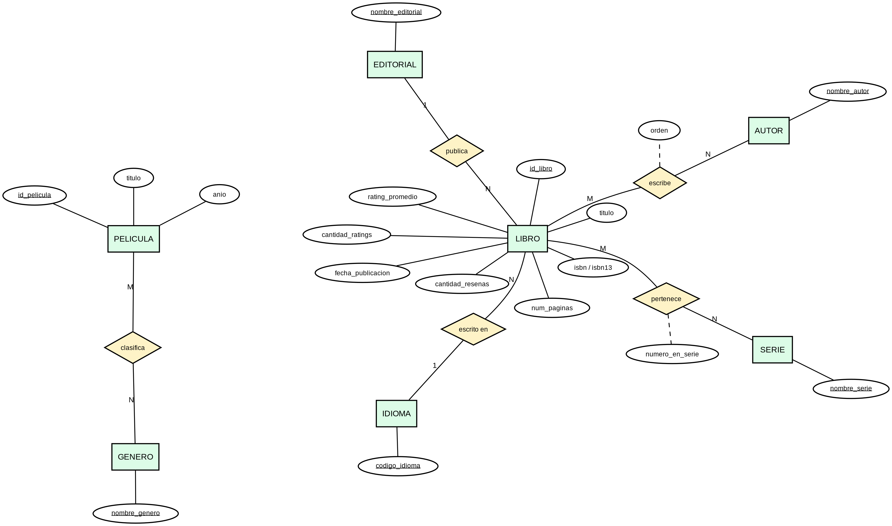
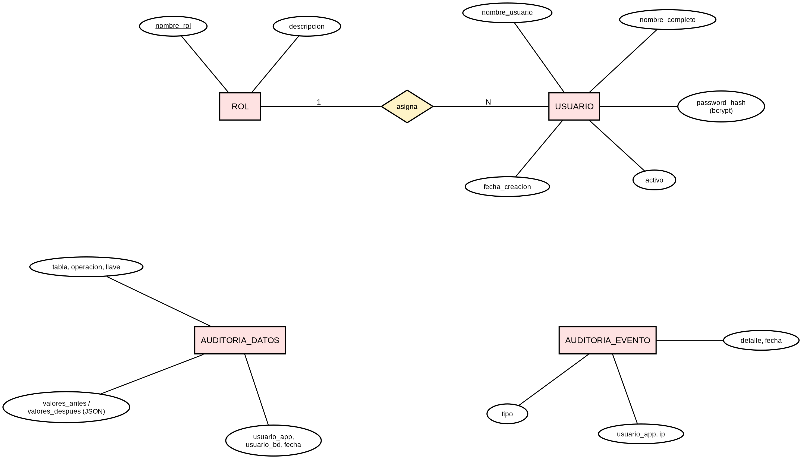
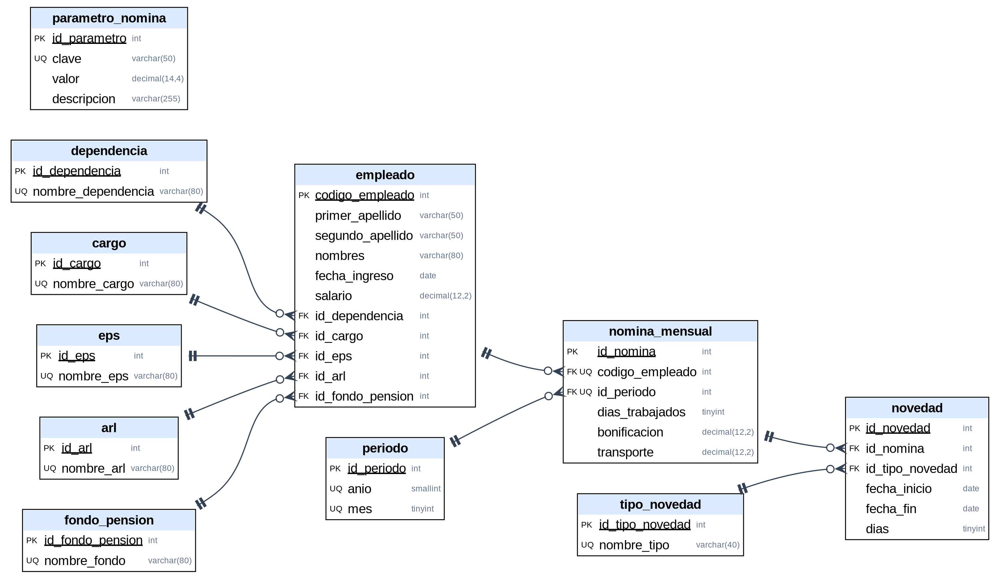
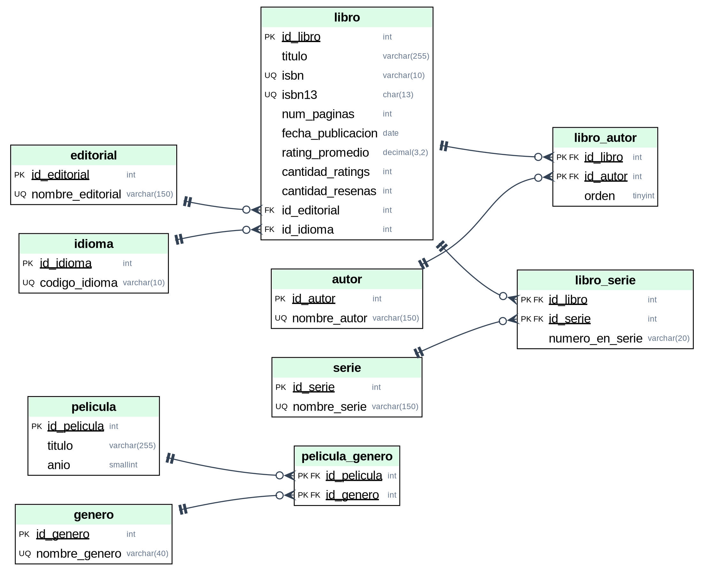
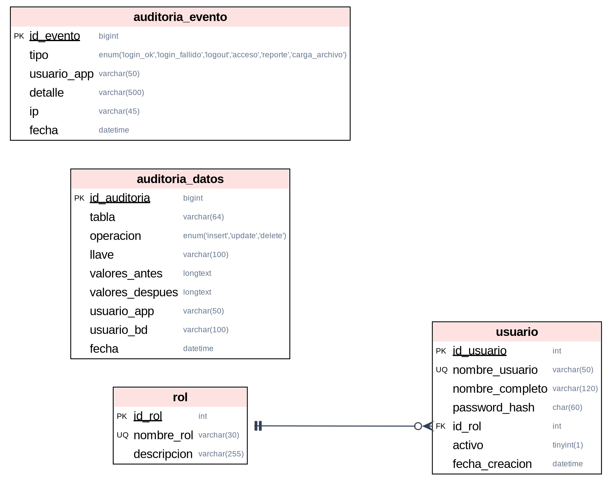
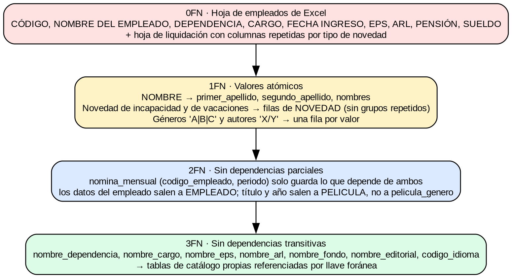
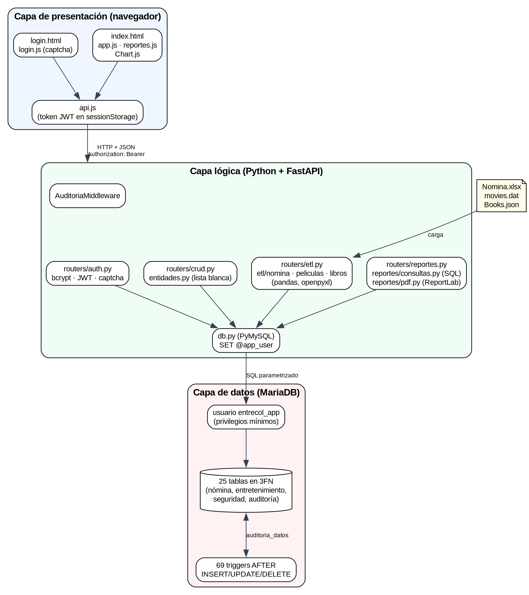
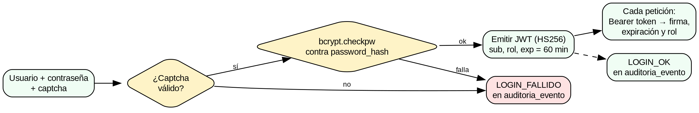
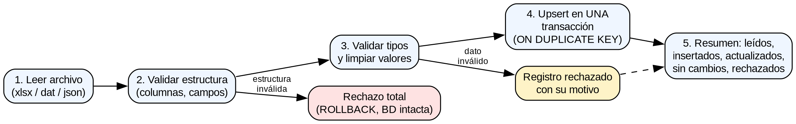

# Resumen

Este informe documenta el diseño y la construcción de la base de datos del sistema de información EntreCOL+, desarrollado por ColPlus-Solutions para centralizar la nómina y el catálogo de entretenimiento de la empresa. A partir de tres orígenes de datos (un libro de Excel de nómina, un archivo DAT de películas y un archivo JSON de libros) se elaboró el modelo entidad-relación, se transformó en un modelo relacional y se convirtió en 25 tablas implementadas en MariaDB. El informe verifica, tabla por tabla, el cumplimiento de la primera, segunda y tercera forma normal (3FN) a partir de las dependencias funcionales de cada relación. También documenta los scripts de creación, las restricciones de integridad, los índices, los 69 triggers de auditoría, el usuario de base de datos con privilegios mínimos, el módulo de extracción, transformación y carga (ETL) y las consultas SQL escritas a mano que alimentan los cinco grupos de reportes. Los resultados muestran una carga completa de 10.681 películas, 11.127 libros y 20 empleados sin registros rechazados, ocho pruebas automatizadas aprobadas y un esquema sin dependencias parciales ni transitivas.

*Palabras clave:* modelo entidad-relación, modelo relacional, normalización, tercera forma normal, MariaDB, SQL, auditoría

EntreCOL+ es una empresa colombiana del sector del entretenimiento multimedia con más de 2.000 empleados. Su gerencia contrató a ColPlus-Solutions para sistematizar, en primer lugar, la nómina, que hoy se liquida en un libro de Excel, y para integrar dos bases de contenido que la empresa conserva en archivos planos. Este informe presenta el proceso de ingeniería de la base de datos que soporta ese sistema: el análisis de los archivos, el modelo entidad-relación (Chen, 1976), el modelo relacional (Codd, 1970), la conversión a tablas, la verificación de la tercera forma normal y la implementación física, junto con las consultas y las decisiones que se tomaron en cada etapa. Los requisitos funcionales (RF) y no funcionales (RNF) que se citan provienen del documento de requisitos del producto del proyecto (Puentes Candanoza, 2026).

# Contexto y Problema

La información de EntreCOL+ presenta tres problemas. Primero, no está estructurada ni relacionada: los datos de un empleado (su dependencia, su EPS o su fondo de pensión) se repiten como texto en cada fila, y las novedades de cada mes ocupan columnas fijas de una hoja de cálculo. Segundo, no existe control de acceso ni registro de quién modifica los datos. Tercero, la empresa no puede generar informes confiables y repetibles sobre su personal ni sobre su catálogo.

El objetivo del proyecto es construir un sistema web que guarde esa información en una base de datos relacional normalizada en 3FN, que permita cargarla, consultarla y modificarla de forma segura y auditada, y que genere los reportes que pide el cliente con gráficos y vista previa en PDF.

# Análisis de los Orígenes de Datos

El diseño partió de una revisión de los tres archivos entregados por el cliente. La Tabla 1 resume la estructura de cada uno.

Tabla: Archivos de Origen y su Estructura
| Archivo | Formato | Estructura | Registros |
|---|---|---|---|
| Nomina.xlsx | Libro de Excel | Hoja de empleados con nueve columnas (código, nombre, dependencia, cargo, fecha de ingreso, EPS, ARL, pensión y sueldo) y una hoja de liquidación con 12 columnas (días trabajados, novedades de incapacidad y vacaciones con sus fechas, bonificación y transporte) | 20 empleados y 20 liquidaciones |
| movies.dat | Texto delimitado | Tres campos separados por "::": identificador, título con el año entre paréntesis y géneros separados por barra vertical | 10.681 películas |
| Books.json | JSON | Lista de objetos con 12 campos (identificador, título, autores separados por barra inclinada, calificación, ISBN, ISBN-13, idioma, páginas, calificaciones, reseñas, fecha de publicación y editorial) y un campo adicional FIELD13 | 11.127 libros |
Nota: Elaboración propia a partir de los archivos del cliente.

La revisión arrojó cinco hallazgos que condicionaron el diseño y el ETL, presentados en la Tabla 2.

Tabla: Hallazgos del Análisis de Datos y Decisión Tomada
| Hallazgo | Decisión |
|---|---|
| Los archivos traen 10.681 películas y 11.127 libros, menos que las cifras del enunciado (65.133 y 45.641) | Se diseñó para el volumen anunciado: índices en las columnas de filtro y listados paginados |
| Cuatro libros llegan con los campos desplazados una posición porque el nombre del autor contenía una coma, y FIELD13 no está vacío | El ETL detecta el desplazamiento y realinea el registro antes de validarlo |
| Aparentemente había un ISBN repetido | Era un efecto de los libros desplazados (el valor 3.58 caía en la columna ISBN); al realinearlos no queda ningún duplicado y se conserva la restricción UNIQUE |
| Una película tiene "(no genres listed)" en lugar de géneros | Se carga sin filas en pelicula_genero; no se crea un género ficticio |
| Un libro tiene 51 autores y dos libros traen fechas imposibles (11/31/2000 y 6/31/1982) | La relación libro_autor admite cualquier cantidad de autores; los libros con fecha imposible se cargan sin fecha y quedan como aviso |
Nota: Elaboración propia.

Del análisis también se identificaron los atributos multivaluados (géneros de una película y autores de un libro), los atributos compuestos (nombre del empleado y título de la película con su año) y los valores repetidos que en realidad son entidades (dependencia, cargo, EPS, ARL, fondo de pensión, editorial e idioma). Estas observaciones guiaron el modelo conceptual.

# Diseño Conceptual: Modelo Entidad-Relación

El modelo entidad-relación (MER) se elaboró con la notación de Chen (1976): los rectángulos son entidades, los rombos son relaciones, las elipses son atributos y los atributos subrayados son identificadores. Las cardinalidades se escriben sobre cada línea (1, N o M). Para mantener legibles los diagramas, el modelo se dividió en tres módulos: nómina, entretenimiento y seguridad.

## Identificación de Entidades

La Tabla 3 lista las entidades identificadas, su origen y su identificador.

Tabla: Entidades del Modelo Entidad-Relación
| Módulo | Entidad | Origen | Identificador |
|---|---|---|---|
| Nómina | EMPLEADO | Hoja de empleados | codigo_empleado |
| Nómina | DEPENDENCIA, CARGO, EPS, ARL, FONDO_PENSION | Columnas de texto repetido de la hoja de empleados | Nombre del catálogo |
| Nómina | PERIODO | Mes de cada hoja de liquidación | (anio, mes) |
| Nómina | NOMINA_MENSUAL | Fila de la hoja de liquidación | (empleado, periodo) |
| Nómina | NOVEDAD y TIPO_NOVEDAD | Columnas de incapacidad y vacaciones | Novedad: generado; tipo: nombre |
| Nómina | PARAMETRO_NOMINA | Regla de negocio (aporte a pensión del 4 %) | clave |
| Entretenimiento | PELICULA y GENERO | movies.dat | id_pelicula; nombre_genero |
| Entretenimiento | LIBRO, AUTOR, EDITORIAL, IDIOMA y SERIE | Books.json | id_libro; nombre de cada catálogo |
| Seguridad | USUARIO, ROL, AUDITORIA_DATOS y AUDITORIA_EVENTO | Requisitos RF-01 a RF-04 y RF-15 a RF-17 | nombre_usuario; nombre_rol; generados |
Nota: Elaboración propia.

## Relaciones y Cardinalidades

La Tabla 4 resume las relaciones del modelo y la regla de negocio que justifica cada cardinalidad.

Tabla: Relaciones del Modelo y sus Cardinalidades
| Relación | Entidades | Cardinalidad | Regla de negocio |
|---|---|---|---|
| pertenece | DEPENDENCIA – EMPLEADO | 1:N | Un empleado trabaja en una sola dependencia; una dependencia tiene muchos empleados |
| ocupa | CARGO – EMPLEADO | 1:N | Un empleado tiene un cargo |
| afiliado EPS / afiliado ARL / cotiza | EPS, ARL, FONDO_PENSION – EMPLEADO | 1:N | Un empleado está afiliado a una EPS, una ARL y un fondo de pensión |
| liquida | EMPLEADO – NOMINA_MENSUAL | 1:N | Un empleado tiene una liquidación por cada mes |
| corresponde | PERIODO – NOMINA_MENSUAL | 1:N | Un periodo agrupa las liquidaciones de todos los empleados |
| registra | NOMINA_MENSUAL – NOVEDAD | 1:N | Una liquidación puede tener cero, una o varias novedades |
| clasifica | TIPO_NOVEDAD – NOVEDAD | 1:N | Cada novedad es de un tipo (incapacidad o vacaciones) |
| clasifica | PELICULA – GENERO | M:N | Una película tiene varios géneros y un género agrupa muchas películas |
| escribe | LIBRO – AUTOR | M:N | Un libro tiene varios autores (hasta 51) y un autor escribe varios libros; la relación tiene el atributo orden |
| pertenece | LIBRO – SERIE | M:N | Un libro puede formar parte de una serie, con su número dentro de ella |
| publica / escrito en | EDITORIAL, IDIOMA – LIBRO | 1:N | Cada libro tiene una editorial y un idioma |
| asigna | ROL – USUARIO | 1:N | Cada usuario tiene un rol (ADMINISTRADOR o CONSULTA) |
Nota: Elaboración propia.

## Diagramas Entidad-Relación

La Figura 1 muestra el módulo de nómina. La entidad central es EMPLEADO, que se relaciona con cinco catálogos. Cada empleado tiene una liquidación por periodo y cada liquidación registra sus novedades. PARAMETRO_NOMINA es una entidad independiente que guarda valores de configuración.


Nota: Elaboración propia, notación de Chen.

La Figura 2 muestra el módulo de entretenimiento. Las relaciones muchos a muchos (clasifica, escribe y pertenece) tienen atributos propios en el caso de los libros: el orden del autor y el número del libro dentro de la serie.


Nota: Elaboración propia, notación de Chen.

La Figura 3 muestra el módulo de seguridad. Las dos entidades de auditoría no se relacionan por llave foránea con las demás, porque deben conservar el registro aunque el dato o el usuario auditado se elimine.


Nota: Elaboración propia, notación de Chen.

# Diseño Lógico: Modelo Relacional

El modelo relacional se obtuvo aplicando las reglas de transformación del MER a relaciones (Elmasri y Navathe, 2016; Silberschatz et al., 2020). La Tabla 5 muestra cómo se aplicó cada regla en este proyecto.

Tabla: Reglas de Transformación del MER al Modelo Relacional
| Regla | Aplicación en EntreCOL+ |
|---|---|
| Cada entidad fuerte se convierte en una relación con sus atributos simples y su identificador como llave primaria | EMPLEADO, PELICULA y LIBRO conservan el identificador del archivo de origen (codigo_empleado, id_pelicula, id_libro) |
| Los atributos compuestos se descomponen en atributos simples | El nombre del empleado se dividió en primer_apellido, segundo_apellido y nombres; el título de la película, en titulo y anio |
| En una relación 1:N, la llave primaria del lado 1 pasa como llave foránea al lado N | empleado recibe id_dependencia, id_cargo, id_eps, id_arl e id_fondo_pension; libro recibe id_editorial e id_idioma |
| Una relación M:N se convierte en una relación propia cuya llave primaria es la combinación de las dos llaves foráneas, más los atributos de la relación | pelicula_genero, libro_autor (con orden) y libro_serie (con numero_en_serie) |
| Los atributos multivaluados se llevan a relaciones aparte | Los géneros y los autores, que llegaban en una sola cadena, se volvieron filas de las tablas intermedias |
| Las entidades con identificador compuesto o débil reciben una llave sustituta y una restricción UNIQUE sobre el identificador natural | periodo (UNIQUE anio, mes) y nomina_mensual (UNIQUE codigo_empleado, id_periodo) |
Nota: Elaboración propia con base en Elmasri y Navathe (2016).

El esquema relacional resultante, en notación textual (llave primaria subrayada con guion bajo al inicio y llaves foráneas marcadas con #), es el siguiente:

```
dependencia(_id_dependencia, nombre_dependencia)
cargo(_id_cargo, nombre_cargo)
eps(_id_eps, nombre_eps)
arl(_id_arl, nombre_arl)
fondo_pension(_id_fondo_pension, nombre_fondo)
periodo(_id_periodo, anio, mes)
tipo_novedad(_id_tipo_novedad, nombre_tipo)
parametro_nomina(_id_parametro, clave, valor, descripcion)
empleado(_codigo_empleado, primer_apellido, segundo_apellido, nombres, fecha_ingreso,
         salario, #id_dependencia, #id_cargo, #id_eps, #id_arl, #id_fondo_pension)
nomina_mensual(_id_nomina, #codigo_empleado, #id_periodo, dias_trabajados, bonificacion, transporte)
novedad(_id_novedad, #id_nomina, #id_tipo_novedad, fecha_inicio, fecha_fin, dias)
pelicula(_id_pelicula, titulo, anio)
genero(_id_genero, nombre_genero)
pelicula_genero(_#id_pelicula, _#id_genero)
editorial(_id_editorial, nombre_editorial)
idioma(_id_idioma, codigo_idioma)
autor(_id_autor, nombre_autor)
serie(_id_serie, nombre_serie)
libro(_id_libro, titulo, isbn, isbn13, num_paginas, fecha_publicacion, rating_promedio,
      cantidad_ratings, cantidad_resenas, #id_editorial, #id_idioma)
libro_autor(_#id_libro, _#id_autor, orden)
libro_serie(_#id_libro, _#id_serie, numero_en_serie)
rol(_id_rol, nombre_rol, descripcion)
usuario(_id_usuario, nombre_usuario, nombre_completo, password_hash, #id_rol, activo, fecha_creacion)
auditoria_datos(_id_auditoria, tabla, operacion, llave, valores_antes, valores_despues,
                usuario_app, usuario_bd, fecha)
auditoria_evento(_id_evento, tipo, usuario_app, detalle, ip, fecha)
```

Las figuras 4, 5 y 6 presentan el modelo relacional con la notación de pata de gallo. Cada caja es una tabla con sus columnas y tipos; PK indica llave primaria, FK llave foránea y UQ restricción de unicidad. Las dos barras marcan el lado "uno" de la relación y la pata de gallo con círculo el lado "cero o muchos". La Figura 4 corresponde al módulo de nómina.


Nota: Elaboración propia, generado a partir de db/01_esquema.sql con docs/diagramas/generar_relacional.py.

La Figura 5 corresponde al módulo de entretenimiento. Las tablas pelicula_genero, libro_autor y libro_serie resuelven las tres relaciones muchos a muchos.


Nota: Elaboración propia, generado a partir de db/01_esquema.sql.

La Figura 6 corresponde al módulo de seguridad y auditoría.


Nota: Elaboración propia, generado a partir de db/02_seguridad.sql.

# Conversión a Tablas

El modelo relacional se convirtió en sentencias CREATE TABLE para MariaDB. Cada tabla declara su llave primaria, sus llaves foráneas, sus restricciones UNIQUE y CHECK, y usa el motor InnoDB, que admite transacciones e integridad referencial. La Tabla 6 resume las 25 tablas; el diccionario de datos completo, columna por columna, está en el Apéndice E.

Tabla: Resumen de las Tablas de la Base de Datos
| Módulo | Tabla | Llave primaria | Llaves foráneas | Filas cargadas |
|---|---|---|---|---|
| Nómina | dependencia | id_dependencia | — | 4 |
| Nómina | cargo | id_cargo | — | 14 |
| Nómina | eps | id_eps | — | 4 |
| Nómina | arl | id_arl | — | 1 |
| Nómina | fondo_pension | id_fondo_pension | — | 4 |
| Nómina | periodo | id_periodo | — | 1 |
| Nómina | tipo_novedad | id_tipo_novedad | — | 2 |
| Nómina | parametro_nomina | id_parametro | — | 1 |
| Nómina | empleado | codigo_empleado | dependencia, cargo, eps, arl, fondo_pension | 20 |
| Nómina | nomina_mensual | id_nomina | empleado, periodo | 20 |
| Nómina | novedad | id_novedad | nomina_mensual, tipo_novedad | 4 |
| Entretenimiento | pelicula | id_pelicula | — | 10.681 |
| Entretenimiento | genero | id_genero | — | 19 |
| Entretenimiento | pelicula_genero | id_pelicula, id_genero | pelicula, genero | 21.563 |
| Entretenimiento | editorial | id_editorial | — | 2.257 |
| Entretenimiento | idioma | id_idioma | — | 27 |
| Entretenimiento | autor | id_autor | — | 9.237 |
| Entretenimiento | serie | id_serie | — | 1.109 |
| Entretenimiento | libro | id_libro | editorial, idioma | 11.127 |
| Entretenimiento | libro_autor | id_libro, id_autor | libro, autor | 19.212 |
| Entretenimiento | libro_serie | id_libro, id_serie | libro, serie | 2.348 |
| Seguridad | rol | id_rol | — | 2 |
| Seguridad | usuario | id_usuario | rol | — |
| Auditoría | auditoria_datos | id_auditoria | — | — |
| Auditoría | auditoria_evento | id_evento | — | — |
Nota: Conteos tomados de la base de datos después de la carga inicial. Las tablas de usuarios y auditoría crecen con el uso.

## Ejemplo de Conversión: la Tabla Empleado

La entidad EMPLEADO ilustra la conversión completa. Su identificador pasa a ser la llave primaria; el nombre compuesto se divide en tres columnas; cada relación 1:N con un catálogo se convierte en una llave foránea, y la regla de negocio "el salario es positivo" se implementa con una restricción CHECK:

```
CREATE TABLE empleado (
  codigo_empleado   INT            NOT NULL,
  primer_apellido   VARCHAR(50)    NOT NULL,
  segundo_apellido  VARCHAR(50)    NULL,
  nombres           VARCHAR(80)    NOT NULL,
  fecha_ingreso     DATE           NOT NULL,
  salario           DECIMAL(12,2)  NOT NULL,
  id_dependencia    INT            NOT NULL,
  id_cargo          INT            NOT NULL,
  id_eps            INT            NOT NULL,
  id_arl            INT            NOT NULL,
  id_fondo_pension  INT            NOT NULL,
  CONSTRAINT pk_empleado PRIMARY KEY (codigo_empleado),
  CONSTRAINT ck_empleado_salario CHECK (salario > 0),
  CONSTRAINT fk_empleado_dependencia FOREIGN KEY (id_dependencia)
    REFERENCES dependencia (id_dependencia) ON UPDATE CASCADE ON DELETE RESTRICT,
  ...
) ENGINE = InnoDB;
```

## Ejemplo de Conversión: una Relación Muchos a Muchos

La relación "escribe" entre LIBRO y AUTOR tiene el atributo orden, que indica la posición del autor en la portada. Se convirtió en una tabla con llave primaria compuesta:

```
CREATE TABLE libro_autor (
  id_libro  INT      NOT NULL,
  id_autor  INT      NOT NULL,
  orden     TINYINT  NOT NULL,
  CONSTRAINT pk_libro_autor PRIMARY KEY (id_libro, id_autor),
  CONSTRAINT ck_libro_autor_orden CHECK (orden >= 1),
  CONSTRAINT fk_la_libro FOREIGN KEY (id_libro)
    REFERENCES libro (id_libro) ON UPDATE CASCADE ON DELETE CASCADE,
  CONSTRAINT fk_la_autor FOREIGN KEY (id_autor)
    REFERENCES autor (id_autor) ON UPDATE CASCADE ON DELETE CASCADE
) ENGINE = InnoDB;
```

## Políticas de Integridad Referencial

Cada llave foránea define qué ocurre al actualizar o eliminar la fila referenciada. La Tabla 7 explica la política elegida en cada caso.

Tabla: Políticas ON UPDATE y ON DELETE de las Llaves Foráneas
| Llaves foráneas | ON DELETE | Razón |
|---|---|---|
| empleado hacia sus cinco catálogos; libro hacia editorial e idioma; usuario hacia rol | RESTRICT | No se puede borrar un catálogo que todavía está en uso; el usuario recibe el mensaje "otros registros dependen de este" |
| nomina_mensual hacia empleado y periodo | RESTRICT | Borrar un empleado no debe borrar en silencio su historia de nómina |
| novedad hacia nomina_mensual | CASCADE | Una novedad no existe sin su liquidación |
| novedad hacia tipo_novedad | RESTRICT | Los tipos de novedad son un catálogo |
| pelicula_genero, libro_autor y libro_serie hacia sus dos tablas | CASCADE | Las filas de una tabla intermedia solo describen la relación; si desaparece un extremo, la relación pierde sentido |
Nota: Todas las llaves foráneas usan ON UPDATE CASCADE. Elaboración propia.

# Verificación de la Tercera Forma Normal

La normalización elimina redundancias y anomalías de inserción, actualización y eliminación descomponiendo las relaciones según sus dependencias funcionales (Codd, 1970; Elmasri y Navathe, 2016). Una relación está en primera forma normal (1FN) si todos sus atributos son atómicos y no tiene grupos repetidos; en segunda forma normal (2FN) si, además, ningún atributo no primo depende de una parte de una llave candidata, y en tercera forma normal (3FN) si, además, ningún atributo no primo depende transitivamente de una llave candidata. La Figura 7 resume cómo se llegó desde los archivos del cliente hasta el esquema en 3FN.


Nota: Elaboración propia.

## Punto de Partida sin Normalizar

Si la hoja de empleados y la hoja de liquidación se llevaran tal cual a una sola tabla, la relación sería:

```
NOMINA_EXCEL(codigo, nombre_empleado, dependencia, cargo, fecha_ingreso, eps, arl, pension,
             sueldo, novedad_incapacidad, novedad_vacaciones, dias_trabajados, dias_incapacidad,
             dias_vacaciones, ini_vacaciones, fin_vacaciones, ini_incapacidad, fin_incapacidad,
             bonificacion, transporte)
```

Esta relación tiene las tres anomalías clásicas. Hay anomalía de actualización porque el nombre de una dependencia o de una EPS se repite en cada empleado y cambiarlo exige modificar muchas filas. Hay anomalía de inserción porque no se puede registrar una EPS sin un empleado afiliado. Hay anomalía de eliminación porque al borrar el único empleado de un cargo se pierde el cargo. En los archivos de entretenimiento ocurre lo mismo: los géneros llegan como "Adventure|Animation|Children" y los autores como "J.K. Rowling/Mary GrandPré".

## Primera Forma Normal

Para alcanzar la 1FN se aplicaron tres transformaciones:

- El nombre del empleado se dividió en primer_apellido, segundo_apellido y nombres, y el título de la película se separó de su año.
- Los atributos multivaluados (géneros y autores) se llevaron a filas de pelicula_genero y libro_autor, una por cada valor.
- Las columnas repetidas de la hoja de liquidación (una pareja de fechas para incapacidad y otra para vacaciones) se convirtieron en filas de la tabla novedad, con su tipo en tipo_novedad. Así, un empleado puede tener cualquier número de novedades en el mes sin agregar columnas.

Todas las tablas resultantes tienen llave primaria, valores atómicos y ningún grupo repetido.

## Segunda Forma Normal

La 2FN solo puede violarse en tablas con llave compuesta. En el diseño, las tablas con llave compuesta (o con identificador natural compuesto) son nomina_mensual, periodo, pelicula_genero, libro_autor y libro_serie. Se verificó en cada una que los atributos no primos dependen de toda la llave:

- En nomina_mensual, los días trabajados, la bonificación y el transporte dependen del empleado **y** del periodo; los datos del empleado (salario, dependencia) dependen solo del empleado y por eso están en la tabla empleado, no en la liquidación.
- En libro_autor, el orden depende del libro y del autor a la vez; en libro_serie, el número dentro de la serie depende del libro y de la serie a la vez.
- En pelicula_genero no hay atributos no primos; el título y el año dependen solo de la película y están en la tabla pelicula.

## Tercera Forma Normal

Para la 3FN se buscaron dependencias transitivas, es decir, atributos no primos que dependen de otro atributo no primo. El caso principal estaba en la hoja de empleados: código → dependencia y, si la dependencia tuviera atributos propios, dependencia → esos atributos. Lo mismo ocurre con cargo, EPS, ARL, pensión, editorial e idioma. La solución fue convertir cada uno en una tabla de catálogo con su propia llave y referenciarla por llave foránea. La Tabla 8 presenta las dependencias funcionales de cada tabla y el resultado de la verificación.

Tabla: Dependencias Funcionales y Verificación de 3FN por Tabla
| Tabla | Dependencias funcionales | 1FN | 2FN | 3FN |
|---|---|---|---|---|
| dependencia, cargo, eps, arl, fondo_pension, genero, editorial, idioma, autor, serie, tipo_novedad, rol | id → nombre; nombre → id (llave candidata UNIQUE) | Sí | Sí (llave simple) | Sí: el único atributo no primo depende de la llave y el nombre es otra llave candidata |
| periodo | id_periodo → anio, mes; (anio, mes) → id_periodo | Sí | Sí: anio y mes forman una llave candidata, no son atributos no primos | Sí |
| parametro_nomina | id_parametro → clave, valor, descripcion; clave → id_parametro, valor, descripcion | Sí | Sí | Sí: clave es llave candidata |
| empleado | codigo_empleado → apellidos, nombres, fecha_ingreso, salario, id_dependencia, id_cargo, id_eps, id_arl, id_fondo_pension | Sí | Sí (llave simple) | Sí: los nombres de los catálogos salieron a sus tablas; no queda ningún atributo que dependa de una llave foránea |
| nomina_mensual | id_nomina → codigo_empleado, id_periodo, dias_trabajados, bonificacion, transporte; (codigo_empleado, id_periodo) → id_nomina y demás | Sí | Sí: los atributos dependen de la combinación completa | Sí |
| novedad | id_novedad → id_nomina, id_tipo_novedad, fecha_inicio, fecha_fin, dias | Sí | Sí | Sí: dias es el número de días de la novedad en el mes liquidado y no se deduce de las fechas cuando la novedad cruza de un mes a otro |
| pelicula | id_pelicula → titulo, anio | Sí | Sí | Sí |
| pelicula_genero | (id_pelicula, id_genero) → ∅ | Sí | Sí | Sí |
| libro | id_libro → titulo, isbn, isbn13, num_paginas, fecha_publicacion, rating_promedio, cantidad_ratings, cantidad_resenas, id_editorial, id_idioma; isbn → id_libro; isbn13 → id_libro | Sí | Sí | Sí: isbn e isbn13 son llaves candidatas (UNIQUE), y una dependencia cuyo determinante es una superllave no viola la 3FN |
| libro_autor | (id_libro, id_autor) → orden | Sí | Sí | Sí |
| libro_serie | (id_libro, id_serie) → numero_en_serie | Sí | Sí | Sí |
| usuario | id_usuario → nombre_usuario, nombre_completo, password_hash, id_rol, activo, fecha_creacion; nombre_usuario → id_usuario | Sí | Sí | Sí |
| auditoria_datos, auditoria_evento | id → demás columnas | Ver nota | Sí | Sí |
Nota: Elaboración propia. Las tablas de auditoría guardan los valores anterior y nuevo como documento JSON; se tratan como un registro histórico inmutable, no como datos de negocio, y por eso ese valor se considera atómico para efectos del modelo (véase la sección Decisiones de Diseño).

## Atributos Derivados que no se Almacenan

La normalización también implicó decidir qué no guardar. El aporte a pensión del empleado se calcula en la consulta como salario multiplicado por el parámetro PORC_APORTE_PENSION_EMPLEADO (0,04), en lugar de guardarse en una columna: si se guardara, dependería del salario, que no es llave, y se rompería la 3FN. Del mismo modo, el nombre completo se arma con CONCAT_WS al consultar, y la cantidad de géneros de una película se cuenta con COUNT en lugar de almacenarse.

Con estas verificaciones se concluye que las 25 tablas del esquema cumplen la tercera forma normal. Además, como en todas las tablas cada determinante es una llave candidata, el esquema también satisface la forma normal de Boyce-Codd.

# Implementación Física en MariaDB

La base de datos se implementó en MariaDB 13.0, motor compatible con MySQL cuyo uso autorizó el docente. La implementación está dividida en cuatro scripts que se ejecutan en orden con scripts/instalar_bd.sh:

1. db/01_esquema.sql crea la base con juego de caracteres utf8mb4 y colación utf8mb4_unicode_ci, las 21 tablas de negocio, los índices y los datos iniciales (tipos de novedad y parámetro de aporte a pensión). Está completo en el Apéndice A.
2. db/02_seguridad.sql crea las tablas rol, usuario, auditoria_datos y auditoria_evento, y los dos roles del sistema (Apéndice B).
3. db/03_triggers.sql crea los 69 triggers de auditoría (Apéndice C).
4. db/04_usuario_app.sql crea el usuario de base de datos de la aplicación con privilegios mínimos (Apéndice D).

El script de instalación es el siguiente:

{{ARCHIVO:scripts/instalar_bd.sh}}

## Colación

El script original del proyecto usaba la colación utf8mb4_0900_ai_ci, que existe en MySQL 8 pero no en MariaDB. Se cambió por utf8mb4_unicode_ci, que compara sin distinguir mayúsculas ni tildes. Esta elección tiene una consecuencia práctica: dos autores escritos con y sin tilde se consideran el mismo valor en la restricción UNIQUE, y el ETL lo maneja dejando una sola fila por autor en cada libro.

## Índices

Además de los índices que MariaDB crea para las llaves primarias, las llaves foráneas y las restricciones UNIQUE, se crearon índices en las columnas por las que filtran y ordenan los reportes (RNF-04):

```
CREATE INDEX ix_empleado_apellidos ON empleado (primer_apellido, segundo_apellido, nombres);
CREATE INDEX ix_novedad_fechas     ON novedad (fecha_inicio, fecha_fin);
CREATE INDEX ix_pelicula_anio      ON pelicula (anio);
CREATE INDEX ix_pg_genero          ON pelicula_genero (id_genero);
CREATE INDEX ix_libro_rating       ON libro (rating_promedio);
CREATE INDEX ix_libro_fecha        ON libro (fecha_publicacion);
CREATE INDEX ix_la_autor           ON libro_autor (id_autor);
CREATE INDEX ix_ls_serie           ON libro_serie (id_serie);
CREATE INDEX ix_aud_datos_fecha    ON auditoria_datos (fecha);
CREATE INDEX ix_aud_evento_fecha   ON auditoria_evento (fecha);
```

Los índices ix_pg_genero, ix_la_autor e ix_ls_serie cubren el segundo componente de las llaves compuestas, que el índice de la llave primaria no aprovecha cuando la consulta parte del género, del autor o de la serie.

# Arquitectura del Sistema

El sistema usa una arquitectura de tres capas desacopladas (RNF-07), como muestra la Figura 8. La capa de presentación es una aplicación de una sola página en HTML, CSS y JavaScript que solo intercambia JSON con la API. La capa lógica, en Python con FastAPI, concentra la autenticación, el CRUD, el ETL, los reportes y la generación de PDF. La capa de datos guarda las tablas y los triggers, y solo la API accede a ella, mediante un usuario con privilegios mínimos.


Nota: Elaboración propia.

Se eligió Python porque el proyecto es intensivo en datos: pandas y openpyxl resuelven la lectura y limpieza del Excel, el DAT y el JSON en pocas líneas, y un solo lenguaje cubre la API, el ETL, la seguridad y los gráficos del PDF (ReportLab y matplotlib). El acceso a datos se hizo con PyMySQL y SQL escrito a mano, sin un ORM, para que todas las consultas queden visibles y documentadas en este informe (RNF-08).

# Seguridad y Auditoría

## Autenticación y Roles

La Figura 9 muestra el flujo de autenticación. El usuario escribe su usuario, su contraseña y el texto de un captcha. La API valida el captcha, busca el usuario con una consulta parametrizada y compara la contraseña con el hash bcrypt guardado en usuario.password_hash (CHAR(60)). Si todo es correcto, emite un token JWT firmado con HS256 que expira en 60 minutos y contiene el rol. Cada petición posterior envía el token y la API verifica su firma, su expiración y el rol antes de ejecutar la acción.


Nota: Elaboración propia.

La consulta de inicio de sesión es la siguiente:

```
SELECT u.id_usuario, u.nombre_usuario, u.nombre_completo, u.password_hash, u.activo, r.nombre_rol
  FROM usuario u
  JOIN rol r ON r.id_rol = u.id_rol
 WHERE u.nombre_usuario = %s
```

## Prevención de Inyección de SQL

Todas las consultas usan marcadores %s y PyMySQL envía los valores por separado, de modo que el texto del usuario nunca forma parte del código SQL (RNF-01; OWASP Foundation, s. f.). Los únicos fragmentos que se interpolan son nombres de tablas y columnas tomados de una lista blanca (backend/app/entidades.py) y la dirección del orden, que solo puede ser ASC o DESC.

## Usuario de Base de Datos con Privilegios Mínimos

La aplicación no se conecta como root. El script 04_usuario_app.sql crea el usuario entrecol_app con los privilegios que muestra la Tabla 9 (RNF-02).

Tabla: Privilegios del Usuario entrecol_app
| Objeto | Privilegios | Razón |
|---|---|---|
| 21 tablas de negocio y usuario | SELECT, INSERT, UPDATE, DELETE | CRUD y carga de archivos |
| rol | SELECT | Los roles son fijos |
| auditoria_datos | SELECT | Solo los triggers escriben en ella; la aplicación no puede alterar ni borrar la auditoría |
| auditoria_evento | SELECT, INSERT | El middleware registra eventos, pero no puede modificarlos ni borrarlos |
| Esquema | Ninguno (sin CREATE, ALTER, DROP) | La aplicación no puede cambiar la estructura de la base |
Nota: Elaboración propia a partir de db/04_usuario_app.sql.

## Auditoría con Triggers

Cada una de las 23 tablas de negocio y seguridad tiene tres triggers AFTER (INSERT, UPDATE y DELETE), para un total de 69 (RF-15). Cada trigger escribe en auditoria_datos la tabla, la operación, la llave, los valores anterior y nuevo como objeto JSON, el usuario de la aplicación y el usuario de la base de datos. Como un trigger no conoce al usuario que inició sesión en la aplicación, la API ejecuta SET @app_user = %s al abrir cada conexión, y el trigger lee esa variable de sesión. El trigger de actualización de empleado ilustra el patrón:

{{ARCHIVO:db/03_triggers.sql:374-408}}

La condición IF NOT (OLD.x <=> NEW.x ...) evita auditar una actualización que no cambia ningún valor, lo que ocurre cuando se recarga el mismo archivo. El operador <=> compara también valores nulos. La contraseña nunca se copia a la auditoría: el trigger de usuario omite la columna password_hash. Los triggers no se escribieron a mano sino con el generador scripts/generar_triggers.py, para que los 69 sigan el mismo patrón sin errores de transcripción.

Los eventos que no cambian datos (inicios de sesión exitosos y fallidos, cierres de sesión, accesos, reportes generados y cargas de archivos) los registra el middleware de la API en auditoria_evento (RF-16):

```
INSERT INTO auditoria_evento (tipo, usuario_app, detalle, ip) VALUES (%s, %s, %s, %s)
```

# Módulo de Carga de Datos (ETL)

El módulo ETL sigue el mismo flujo para los tres orígenes (RF-05 a RF-10), representado en la Figura 10: lee el archivo, valida la estructura, valida y limpia cada registro, inserta o actualiza dentro de una sola transacción y devuelve un resumen. Si la estructura no corresponde, la carga se rechaza completa y la base queda como estaba; si un registro individual es inválido, se rechaza con su motivo y el resto continúa.


Nota: Elaboración propia.

## Recarga sin Duplicados

Para que un archivo con la misma estructura pueda cargarse de nuevo sin duplicar registros (RF-09), todas las inserciones usan INSERT ... ON DUPLICATE KEY UPDATE sobre la llave primaria o la llave natural. MariaDB devuelve 1 si insertó, 2 si actualizó y 0 si la fila no cambió, y con esos valores se arma el resumen. La carga de películas es un ejemplo:

```
INSERT INTO pelicula (id_pelicula, titulo, anio) VALUES (%s, %s, %s)
ON DUPLICATE KEY UPDATE titulo = VALUES(titulo), anio = VALUES(anio)
```

Los valores de catálogo (géneros, editoriales, autores, dependencias, entre otros) se buscan por nombre y solo se insertan si no existen:

```
SELECT id_genero FROM genero WHERE nombre_genero = %s
INSERT INTO genero (nombre_genero) VALUES (%s)
```

Las relaciones de cada película se sincronizan: se borran los géneros que ya no están en el archivo y se agregan los nuevos con INSERT IGNORE. En los libros y las novedades, las relaciones solo se reescriben si cambiaron, para no llenar la auditoría de cambios que no lo son. En la carga de libros, cada libro se procesa dentro de un SAVEPOINT: si viola una restricción, se revierte solo ese libro y se informa el motivo.

## Transformaciones por Archivo

En la nómina, el ETL normaliza los nombres de las columnas (sin tildes ni espacios dobles), convierte la fecha de ingreso de AAAAMMDD a DATE, divide el nombre (las dos primeras palabras son los apellidos) y crea el periodo de cada hoja de liquidación. Como la hoja no indica el mes, el periodo se toma del nombre de la hoja, del año y mes que el usuario escribe al cargar o, si no hay ninguno, del mes de la novedad más antigua (03/2022 con el archivo actual). En las películas, una expresión regular separa el título del año y los géneros se dividen por la barra vertical. En los libros, el ETL realinea los registros desplazados, divide los autores por la barra inclinada, convierte la fecha de mes/día/año y extrae la serie del título, por ejemplo "Harry Potter #6".

# Consultas SQL de los Reportes

Los reportes se construyen con consultas escritas a mano en backend/app/reportes/consultas.py (RF-12, RNF-08). Los parámetros que elige el usuario (rango de fechas, valor de N y orden ascendente o descendente) viajan como parámetros de la consulta. La Tabla 10 resume las técnicas de SQL empleadas en cada reporte.

Tabla: Consultas por Reporte y Técnicas de SQL Empleadas
| Reporte | Contenido | Técnicas |
|---|---|---|
| Nómina | Cantidad y lista de empleados; por dependencia; por dependencia y cargo; gráfico de torta y de barras | JOIN de tres tablas, LEFT JOIN para incluir dependencias sin empleados, GROUP BY, COUNT, ORDER BY dinámico |
| Información personal | Ficha del empleado, aporte a pensión, liquidaciones y novedades | JOIN de seis tablas, subconsulta escalar sobre parametro_nomina, DATE_FORMAT, LPAD |
| Salud y pensión | Frecuencia por EPS y por fondo; cruces con dependencia y cargo | LEFT JOIN, GROUP BY de dos columnas, consulta parametrizada por catálogo |
| Novedades | Empleados con novedades entre dos meses; cantidad por dependencia y por cargo | Condición de solapamiento de rangos, COUNT(DISTINCT) |
| Entretenimiento | Películas por género; Top N de libros; Top 5 mejor y peor por año; películas con N géneros; frecuencias | HAVING, LIMIT parametrizado, expresión de tabla común (WITH), función de ventana ROW_NUMBER() OVER (PARTITION BY) |
| Auditoría | Eventos y cambios de datos entre fechas, por usuario | Filtro opcional con (%s = '' OR columna = %s), DATE_ADD, LEFT para recortar el JSON |
Nota: Elaboración propia.

## Reporte de Nómina

La cantidad de empleados por dependencia usa LEFT JOIN para que una dependencia sin empleados aparezca con cero:

```
SELECT dp.nombre_dependencia AS dependencia, COUNT(e.codigo_empleado) AS n
  FROM dependencia dp
  LEFT JOIN empleado e ON e.id_dependencia = dp.id_dependencia
 GROUP BY dp.id_dependencia, dp.nombre_dependencia
 ORDER BY dp.nombre_dependencia ASC
```

El conteo por dependencia y cargo alimenta el gráfico de barras comparativas:

```
SELECT dp.nombre_dependencia AS dependencia, c.nombre_cargo AS cargo, COUNT(*) AS n
  FROM empleado e
  JOIN dependencia dp ON dp.id_dependencia = e.id_dependencia
  JOIN cargo c        ON c.id_cargo = e.id_cargo
 GROUP BY dp.nombre_dependencia, c.nombre_cargo
 ORDER BY dp.nombre_dependencia ASC, c.nombre_cargo ASC
```

## Reporte de Información Personal

La ficha del empleado reúne los seis catálogos y calcula el aporte a pensión con una subconsulta sobre el parámetro, en lugar de almacenarlo:

```
SELECT e.codigo_empleado,
       CONCAT_WS(' ', e.primer_apellido, e.segundo_apellido, e.nombres) AS nombre,
       dp.nombre_dependencia, c.nombre_cargo,
       DATE_FORMAT(e.fecha_ingreso, '%d/%m/%Y') AS fecha_ingreso,
       s.nombre_eps, a.nombre_arl, f.nombre_fondo, e.salario,
       ROUND(e.salario * COALESCE(
         (SELECT valor FROM parametro_nomina WHERE clave = 'PORC_APORTE_PENSION_EMPLEADO'), 0), 2)
         AS aporte_pension
  FROM empleado e
  JOIN dependencia dp  ON dp.id_dependencia = e.id_dependencia
  JOIN cargo c         ON c.id_cargo = e.id_cargo
  JOIN eps s           ON s.id_eps = e.id_eps
  JOIN arl a           ON a.id_arl = e.id_arl
  JOIN fondo_pension f ON f.id_fondo_pension = e.id_fondo_pension
 WHERE e.codigo_empleado = %s
```

## Reporte de Novedades

El usuario elige un rango en formato MM/AAAA. La API lo convierte en el primer día del mes inicial y el último día del mes final, y una novedad entra en el reporte si su intervalo se solapa con el rango:

```
SELECT e.codigo_empleado, CONCAT_WS(' ', e.primer_apellido, e.segundo_apellido, e.nombres) AS nombre,
       dp.nombre_dependencia, c.nombre_cargo, t.nombre_tipo,
       DATE_FORMAT(v.fecha_inicio, '%d/%m/%Y') AS inicio,
       DATE_FORMAT(v.fecha_fin, '%d/%m/%Y') AS fin, v.dias
  FROM novedad v
  JOIN tipo_novedad t   ON t.id_tipo_novedad = v.id_tipo_novedad
  JOIN nomina_mensual n ON n.id_nomina = v.id_nomina
  JOIN empleado e       ON e.codigo_empleado = n.codigo_empleado
  JOIN dependencia dp   ON dp.id_dependencia = e.id_dependencia
  JOIN cargo c          ON c.id_cargo = e.id_cargo
 WHERE v.fecha_inicio <= %s AND v.fecha_fin >= %s
 ORDER BY e.primer_apellido ASC, e.segundo_apellido ASC, e.nombres ASC, v.fecha_inicio ASC
```

La cantidad de empleados con novedades por dependencia usa COUNT(DISTINCT), porque un mismo empleado puede tener varias novedades en el rango.

## Reporte de la Base de Entretenimiento

Las películas con exactamente N géneros se obtienen con HAVING sobre el conteo; el LEFT JOIN permite consultar también las películas con cero géneros:

```
SELECT p.id_pelicula, p.titulo, p.anio, COUNT(pg.id_genero) AS generos
  FROM pelicula p
  LEFT JOIN pelicula_genero pg ON pg.id_pelicula = p.id_pelicula
 GROUP BY p.id_pelicula, p.titulo, p.anio
HAVING COUNT(pg.id_genero) = %s
 ORDER BY p.titulo ASC
```

El Top N de libros ordena por calificación y desempata por la cantidad de calificaciones, de modo que un libro con una sola calificación de 5 no supere a uno con miles:

```
SELECT l.titulo, YEAR(l.fecha_publicacion) AS anio, l.rating_promedio, l.cantidad_ratings
  FROM libro l
 WHERE l.rating_promedio IS NOT NULL AND l.cantidad_ratings > 0
 ORDER BY l.rating_promedio DESC, l.cantidad_ratings DESC, l.titulo ASC
 LIMIT %s
```

El Top 5 de libros con mejor y peor calificación por año es la consulta más compleja. Usa una expresión de tabla común y dos funciones de ventana que numeran los libros de cada año en orden descendente y ascendente:

```
WITH clasificados AS (
    SELECT YEAR(l.fecha_publicacion) AS anio, l.titulo, l.rating_promedio, l.cantidad_ratings,
           ROW_NUMBER() OVER (PARTITION BY YEAR(l.fecha_publicacion)
                              ORDER BY l.rating_promedio DESC, l.cantidad_ratings DESC) AS mejor,
           ROW_NUMBER() OVER (PARTITION BY YEAR(l.fecha_publicacion)
                              ORDER BY l.rating_promedio ASC, l.cantidad_ratings DESC) AS peor
      FROM libro l
     WHERE l.fecha_publicacion IS NOT NULL AND l.cantidad_ratings > 0
       AND YEAR(l.fecha_publicacion) BETWEEN %s AND %s)
SELECT anio, CASE WHEN mejor <= 5 THEN 'Mejor' ELSE 'Peor' END AS grupo,
       CASE WHEN mejor <= 5 THEN mejor ELSE peor END AS puesto,
       titulo, rating_promedio, cantidad_ratings
  FROM clasificados
 WHERE mejor <= 5 OR peor <= 5
 ORDER BY anio ASC, grupo ASC, puesto ASC
```

## Consultas del CRUD

El CRUD genérico (RF-11) arma sus sentencias a partir del catálogo de entidades. Los nombres de tabla y columna salen de la lista blanca y los valores siempre son parámetros. Los listados están paginados con LIMIT y OFFSET (RNF-04):

```
SELECT COUNT(*) AS n FROM (<consulta de listado> WHERE <columna de búsqueda> LIKE %s) t
<consulta de listado> WHERE <columna de búsqueda> LIKE %s ORDER BY <orden> LIMIT %s OFFSET %s
INSERT INTO <tabla> (<columnas>) VALUES (%s, %s, ...)
UPDATE <tabla> SET <columna> = %s, ... WHERE <llave> = %s
DELETE FROM <tabla> WHERE <llave> = %s
```

Cuando MariaDB rechaza una operación por una restricción, la API traduce el código de error en un mensaje claro: 1062 (valor único repetido), 1451 (el registro tiene dependientes), 1452 (la referencia no existe) y 4025 (no cumple una restricción CHECK).

# Pruebas y Resultados

La base se creó con scripts/instalar_bd.sh y se cargó con los archivos originales del cliente. La Tabla 11 presenta el resultado de la carga, tomado del registro de auditoría.

Tabla: Resultado de la Carga Inicial de los Archivos del Cliente
| Archivo | Insertados | Actualizados | Rechazados | Observaciones |
|---|---|---|---|---|
| Nomina.xlsx | 40 | 0 | 0 | 20 empleados y 20 liquidaciones del periodo 03/2022, con cuatro novedades |
| movies.dat | 10.681 | 0 | 0 | 19 géneros y 21.563 relaciones; una película sin géneros |
| Books.json | 11.127 | 0 | 0 | Cuatro libros realineados; dos libros sin fecha; 9.237 autores, 2.257 editoriales y 1.109 series |
Nota: Datos de la tabla auditoria_evento del 17 de noviembre de 2026.

Además, el proyecto incluye ocho pruebas automatizadas con pytest sobre el ETL y la generación de PDF, descritas en la Tabla 12. Las ocho pruebas se ejecutan con uv run pytest y todas pasan.

Tabla: Pruebas Automatizadas del Proyecto
| Prueba | Qué verifica |
|---|---|
| test_peliculas_archivo_real | El archivo movies.dat se lee completo, con sus géneros y la película sin géneros |
| test_peliculas_estructura_invalida | Un archivo con otra estructura se rechaza completo |
| test_peliculas_rechaza_registro_sin_anio | Un registro sin año se rechaza con su motivo |
| test_libros_archivo_real | Books.json se lee completo y los cuatro libros desplazados se realinean |
| test_libros_estructura_invalida | Un JSON sin los campos esperados se rechaza |
| test_nomina_archivo_real | El libro de Excel produce 20 empleados, su liquidación y sus novedades |
| test_nomina_periodo_indicado | El periodo escrito al cargar tiene prioridad sobre el deducido |
| test_pdf_generico | Un reporte con tablas, gráficos e indicadores se convierte en un PDF válido |
Nota: Elaboración propia a partir de tests/test_etl.py.

También se verificó la recarga (RF-09) ejecutando de nuevo el ETL dentro de una transacción que luego se revirtió. La segunda carga de movies.dat informó 10.681 registros sin cambios, cero insertados, cero actualizados y ninguna fila nueva en auditoria_datos. La segunda carga de Nomina.xlsx no insertó ningún registro y solo actualizó los siete empleados y la novedad que se habían modificado desde el CRUD después de la carga inicial, devolviéndolos a los valores del archivo; los triggers registraron exactamente esos cambios con su valor anterior y nuevo. Por último, las rutas del CRUD de escritura, de la carga de archivos y de la auditoría exigen el rol ADMINISTRADOR en el servidor, de modo que el rol CONSULTA recibe un error 403 aunque intente llamarlas directamente.

# Decisiones de Diseño

La Tabla 13 recoge las decisiones más relevantes tomadas durante el proceso y su justificación.

Tabla: Decisiones de Diseño y su Justificación
| Decisión | Justificación |
|---|---|
| Conservar los identificadores del cliente (codigo_empleado, id_pelicula, id_libro) como llaves primarias | Son estables y únicos en el origen, y permiten recargar archivos sin duplicar registros |
| Llaves sustitutas AUTO_INCREMENT en los catálogos, con UNIQUE sobre el nombre | Las llaves enteras son más compactas en las llaves foráneas, y el UNIQUE conserva la identidad natural |
| Separar periodo de nomina_mensual | Permite liquidar varios meses sin columnas por mes y filtrar por periodo |
| Modelar las novedades como filas con tipo, no como columnas | Elimina grupos repetidos (1FN) y admite nuevos tipos de novedad sin cambiar el esquema |
| Guardar el porcentaje de aporte a pensión en parametro_nomina y calcular el aporte en la consulta | El aporte es un atributo derivado; guardarlo rompería la 3FN y quedaría desactualizado si cambia el salario |
| Guardar ISBN e ISBN-13 como texto con UNIQUE y permitir nulos | Los ISBN pueden empezar en cero o terminar en X; algunos libros no los traen |
| Guardar los valores de auditoría como JSON | Un solo esquema de auditoría sirve para las 23 tablas; el registro es histórico e inmutable y no participa en las consultas de negocio |
| No relacionar la auditoría por llave foránea | El registro debe sobrevivir a la eliminación del dato o del usuario auditado |
| Triggers generados por un script | Garantiza que los 69 triggers sean idénticos en estructura y facilita regenerarlos si cambia una tabla |
| SQL escrito a mano con PyMySQL en lugar de un ORM | Las consultas quedan visibles y documentadas, como exige el proyecto |
| Colación utf8mb4_unicode_ci | La colación del script original no existe en MariaDB |
Nota: Elaboración propia.

# Conclusiones

El proceso partió de tres archivos sin estructura relacional y terminó en un esquema de 25 tablas en tercera forma normal, implementado en MariaDB con llaves primarias y foráneas, restricciones UNIQUE y CHECK en todas las tablas, e índices en las columnas de filtro. La verificación tabla por tabla mostró que no quedan grupos repetidos, dependencias parciales ni dependencias transitivas, y que los únicos datos que podrían derivarse (aporte a pensión, nombre completo, cantidad de géneros) se calculan en las consultas en lugar de almacenarse.

El diseño también resolvió los problemas de calidad de los datos del cliente sin relajar las restricciones: los libros desplazados se realinean, las fechas imposibles se cargan como nulas con aviso y las recargas no duplican registros. La seguridad se aplicó en la propia base de datos, con un usuario de privilegios mínimos que no puede modificar la estructura ni la auditoría, y con triggers que registran cada cambio aunque se haga fuera de la aplicación. Por último, las consultas de los reportes aprovechan las capacidades del motor (funciones de ventana, expresiones de tabla común y agregaciones) para entregar en una sola consulta lo que antes exigía trabajo manual en hojas de cálculo.

# Referencias

Chen, P. P.-S. (1976). The entity-relationship model—Toward a unified view of data. *ACM Transactions on Database Systems*, *1*(1), 9–36. https://doi.org/10.1145/320434.320440

Codd, E. F. (1970). A relational model of data for large shared data banks. *Communications of the ACM*, *13*(6), 377–387. https://doi.org/10.1145/362384.362685

Elmasri, R. y Navathe, S. B. (2016). *Fundamentals of database systems* (7.ª ed.). Pearson.

OWASP Foundation. (s. f.). *SQL injection prevention cheat sheet*. https://cheatsheetseries.owasp.org/cheatsheets/SQL_Injection_Prevention_Cheat_Sheet.html

Puentes Candanoza, J. P. (2026). *Documento de requisitos del producto (PRD) del sistema de información EntreCOL+* [Documento no publicado]. Facultad de Ingeniería, Universidad Manuela Beltrán.

Silberschatz, A., Korth, H. F. y Sudarshan, S. (2020). *Database system concepts* (7.ª ed.). McGraw-Hill Education.

# Apéndice A. Script de Creación del Esquema (db/01_esquema.sql)

{{ARCHIVO:db/01_esquema.sql}}

# Apéndice B. Script de Seguridad y Auditoría (db/02_seguridad.sql)

{{ARCHIVO:db/02_seguridad.sql}}

# Apéndice C. Triggers de Auditoría (db/03_triggers.sql)

El archivo completo tiene 1.119 líneas con 69 triggers que siguen el mismo patrón. Se incluyen los tres triggers de la tabla empleado como muestra y el generador que produce el archivo completo.

{{ARCHIVO:db/03_triggers.sql:1-4}}

{{ARCHIVO:db/03_triggers.sql:353-430}}

{{ARCHIVO:scripts/generar_triggers.py}}

# Apéndice D. Usuario de la Aplicación (db/04_usuario_app.sql)

{{ARCHIVO:db/04_usuario_app.sql}}

# Apéndice E. Diccionario de Datos

Las tablas de este apéndice se generaron automáticamente a partir de los scripts db/01_esquema.sql y db/02_seguridad.sql con docs/construir.py, de modo que coinciden exactamente con la base implementada.

{{DICCIONARIO}}
