# Resumen

Este manual explica el funcionamiento del sistema de información EntreCOL+, una aplicación web que centraliza la nómina y el catálogo de entretenimiento (películas y libros) de la empresa EntreCOL+. Describe la instalación, el ingreso con usuario, contraseña y captcha, la navegación por módulos, los dos roles del sistema, los cinco grupos de reportes con sus gráficos y su vista previa en PDF, la administración de datos (crear, consultar, modificar y eliminar), la carga de archivos de Excel, DAT y JSON, y el reporte de auditoría. Cada pantalla se presenta con una captura y con los pasos para usarla, y al final se incluyen los mensajes de error más frecuentes con su solución y un glosario.

*Palabras clave:* manual de usuario, sistema de información, nómina, reportes, auditoría

EntreCOL+ es un sistema de información web desarrollado por ColPlus-Solutions para la empresa EntreCOL+. Permite consultar la información de los empleados y de su nómina mensual, consultar un catálogo de más de 10.000 películas y 11.000 libros, generar reportes con gráficos que se pueden ver en pantalla, guardar en PDF o imprimir, y mantener un registro de quién hizo cada cambio. Este manual está dirigido a dos tipos de usuario: el personal de gerencia o de talento humano, que consulta reportes, y el personal de tecnología o de nómina, que además administra los datos y carga los archivos.

# Requisitos del Sistema

Para usar EntreCOL+ basta con un navegador web actualizado. La instalación del servidor la realiza una sola vez el área de tecnología. La Tabla 1 resume los requisitos.

Tabla: Requisitos para Usar e Instalar el Sistema
| Componente | Requisito |
|---|---|
| Navegador del usuario | Google Chrome, Microsoft Edge o Mozilla Firefox en una versión reciente, con JavaScript habilitado |
| Pantalla | Resolución mínima recomendada de 1280 × 720 píxeles |
| Servidor | Python 3.12 o superior y el gestor de paquetes uv |
| Base de datos | MariaDB en versión LTS (o MySQL compatible) |
| Red | Acceso al servidor por el puerto 8000; el captcha local no requiere internet |
Nota: Elaboración propia.

# Instalación y Puesta en Marcha

Esta sección es para el administrador técnico. Los comandos se ejecutan en una terminal desde la carpeta raíz del proyecto.

1. Copie el archivo de configuración de ejemplo y ajuste la contraseña de la base de datos (DB_PASSWORD) y el secreto de los tokens (JWT_SECRET).
2. Instale las dependencias de Python.
3. Cree la base de datos, las tablas, los triggers y el usuario de la aplicación.
4. Cree el primer usuario administrador; el programa le pedirá una contraseña de al menos ocho caracteres.
5. Inicie el servidor.

```
cp .env.example .env
uv sync
sudo ./scripts/instalar_bd.sh
uv run python scripts/crear_admin.py
uv run python scripts/crear_admin.py gerente "Gerente General" CONSULTA
uv run uvicorn app.main:app --app-dir backend
```

Con el servidor en marcha, la aplicación queda disponible en http://localhost:8000. La primera vez, ingrese como administrador y cargue los archivos del cliente desde el módulo Carga de archivos (véase la sección Carga de Archivos). Si necesita borrar la base de datos y crearla de nuevo, ejecute el instalador con la opción --recrear; esta operación elimina todos los datos.

# Roles y Permisos

Todo usuario debe iniciar sesión antes de usar el sistema, y lo que puede hacer depende de su rol. La Tabla 2 compara los dos roles.

Tabla: Funciones Disponibles para Cada Rol
| Función | Administrador | Consulta |
|---|---|---|
| Iniciar y cerrar sesión | Sí | Sí |
| Generar los cinco reportes, verlos en pantalla, en PDF e imprimirlos | Sí | Sí |
| Consultar, crear, modificar y eliminar datos (CRUD) | Sí | No |
| Gestionar usuarios del sistema | Sí | No |
| Cargar archivos de nómina, películas y libros | Sí | No |
| Consultar el reporte de auditoría | Sí | No |
Nota: Las restricciones se validan en el servidor; ocultar un menú no es la única protección.

# Ingreso al Sistema

## Iniciar Sesión

Al abrir la dirección del sistema aparece la pantalla de inicio de sesión que muestra la Figura 1. Para ingresar:

1. Escriba su nombre de usuario en el campo Usuario.
2. Escriba su contraseña en el campo Contraseña.
3. Escriba en el último campo el texto que aparece en la imagen del captcha. No distingue mayúsculas de minúsculas. Si no lo puede leer, presione el botón con la flecha circular para generar otro.
4. Presione Ingresar.

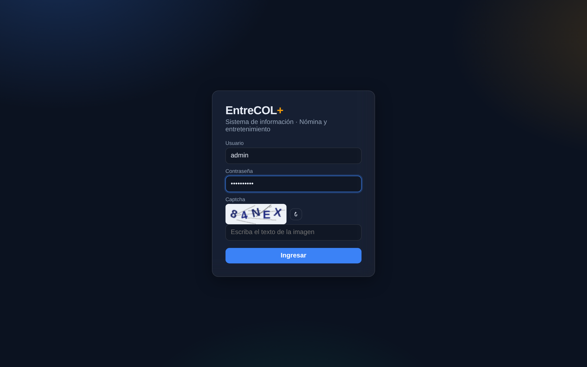
Nota: Captura del sistema EntreCOL+.

Si los datos son correctos, el sistema abre la pantalla de inicio. Si el captcha es incorrecto o ya expiró, o si el usuario o la contraseña no coinciden, aparece un mensaje en rojo debajo del botón, como en la Figura 2, y el captcha cambia automáticamente. Cada captcha sirve para un solo intento y vence a los cinco minutos. Todos los intentos, exitosos o fallidos, quedan registrados en la auditoría.

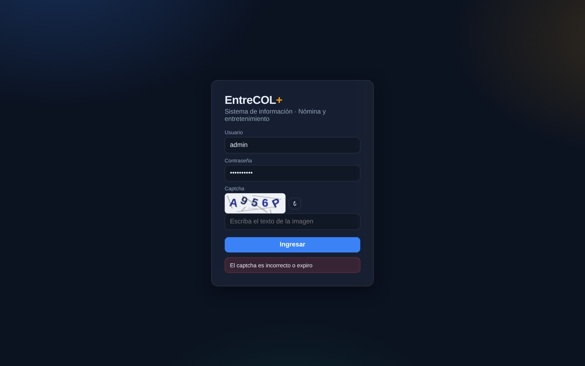
Nota: Captura del sistema EntreCOL+.

## Cerrar Sesión y Expiración

Para salir, presione Cerrar sesión en la parte inferior del menú lateral. Por seguridad, la sesión vence automáticamente a los 60 minutos; cuando eso ocurre, el sistema muestra el aviso "La sesión expiró. Inicie sesión de nuevo" y lo lleva a la pantalla de ingreso. La sesión también se cierra al cerrar la pestaña del navegador.

# Pantalla de Inicio y Navegación

Después de ingresar, la pantalla se divide en dos partes: el menú lateral a la izquierda, con el nombre y el rol del usuario en la parte inferior, y el área de trabajo a la derecha. La Figura 3 muestra la pantalla de inicio de un administrador, con tarjetas de acceso directo a cada reporte. El menú lateral tiene cinco opciones: Inicio, Reportes, Datos (CRUD), Carga de archivos y Auditoría.

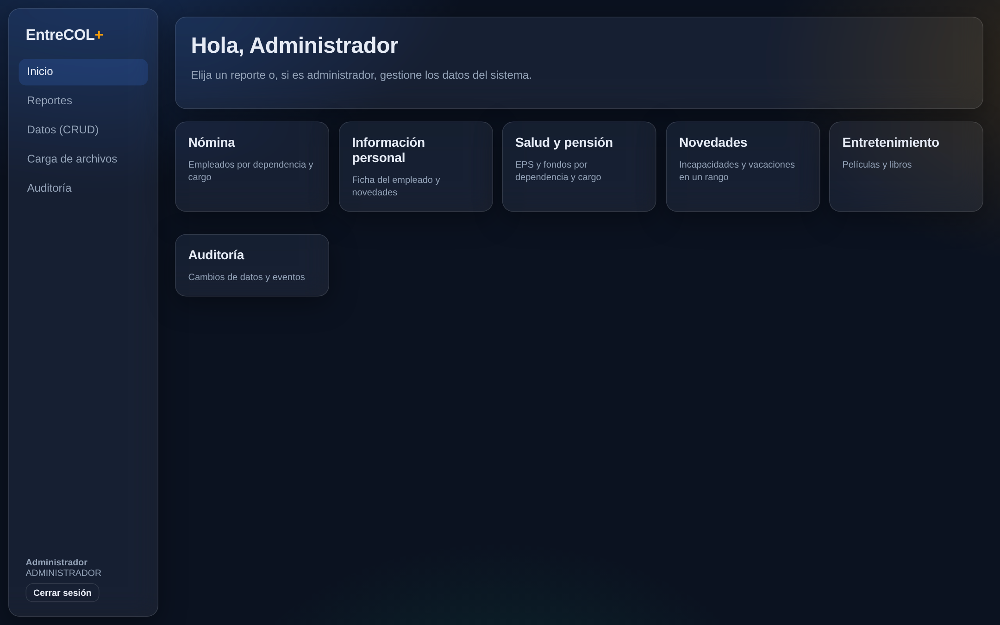
Nota: Captura del sistema EntreCOL+.

Un usuario con rol Consulta ve solo las opciones Inicio y Reportes, como muestra la Figura 4.

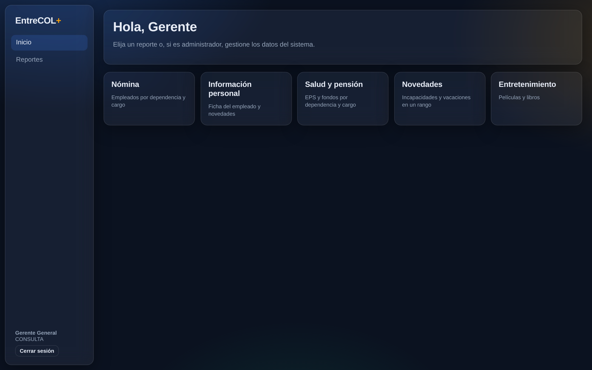
Nota: Captura del sistema EntreCOL+.

# Reportes

## Uso General de los Reportes

Todos los reportes funcionan igual. En la opción Reportes, las pestañas de la parte superior permiten elegir el reporte. Cada reporte tiene un formulario de parámetros y dos botones:

- **Generar** muestra el reporte en pantalla, con indicadores numéricos en la parte superior, tablas y gráficos interactivos. Al pasar el cursor sobre un gráfico se ve el valor exacto.
- **Vista previa PDF** genera el mismo reporte en PDF y lo muestra en una ventana dentro de la página, con los botones Imprimir, Descargar y Cerrar.

La Tabla 3 resume los parámetros de cada reporte. En todas las listas usted decide si los nombres se ordenan de forma ascendente o descendente; las dependencias, los cargos, las EPS y los fondos de pensión se ordenan siempre de forma ascendente. Cuando una lista tiene más de 1.000 filas, la pantalla y el PDF muestran las primeras 1.000 y lo indican en una nota, pero los totales siempre se calculan sobre todos los registros.

Tabla: Reportes Disponibles y sus Parámetros
| Reporte | Parámetros | Qué muestra |
|---|---|---|
| Nómina | Orden de nombres | Cantidad y lista de empleados; cantidad y lista por dependencia y por cargo; gráfico de torta por dependencia; barras por dependencia y cargo |
| Información personal | Empleado | Datos del empleado, aporte a pensión, liquidaciones y novedades |
| Salud y pensión | Orden de nombres | Frecuencia por EPS y por fondo de pensión; cruces con dependencia; cantidad y lista por cargo |
| Novedades | Desde y hasta (MM/AAAA), orden de nombres | Empleados con incapacidades o vacaciones en el rango y cantidad por dependencia y por cargo |
| Entretenimiento | Año desde, año hasta, Top N, N géneros, orden de títulos | Películas por género, Top N de libros, Top 5 mejor y peor por año, películas con N géneros y frecuencias |
| Auditoría (solo administrador) | Desde, hasta, usuario (opcional) | Eventos y cambios de datos |
Nota: Elaboración propia.

## Reporte de Nómina

Seleccione el orden de los nombres y presione Generar. La parte superior muestra la cantidad de empleados, de dependencias y de cargos, y debajo aparece la lista de empleados con su código, nombre, dependencia y cargo, como en la Figura 5.

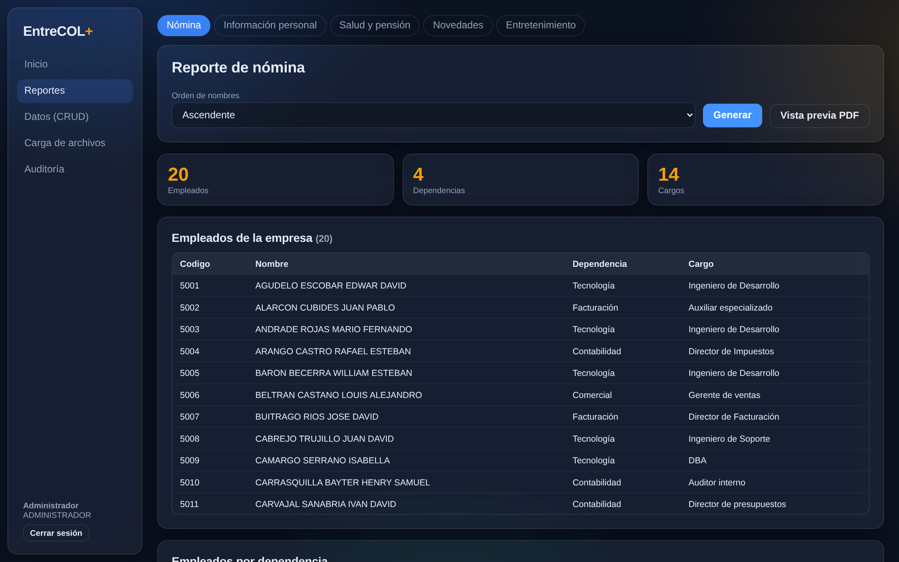
Nota: Captura del sistema EntreCOL+.

Más abajo se encuentran el gráfico de torta de empleados por dependencia, las tablas de cantidad y lista por dependencia, y el gráfico de barras comparativas por dependencia y cargo. La Figura 6 muestra esa parte del reporte.

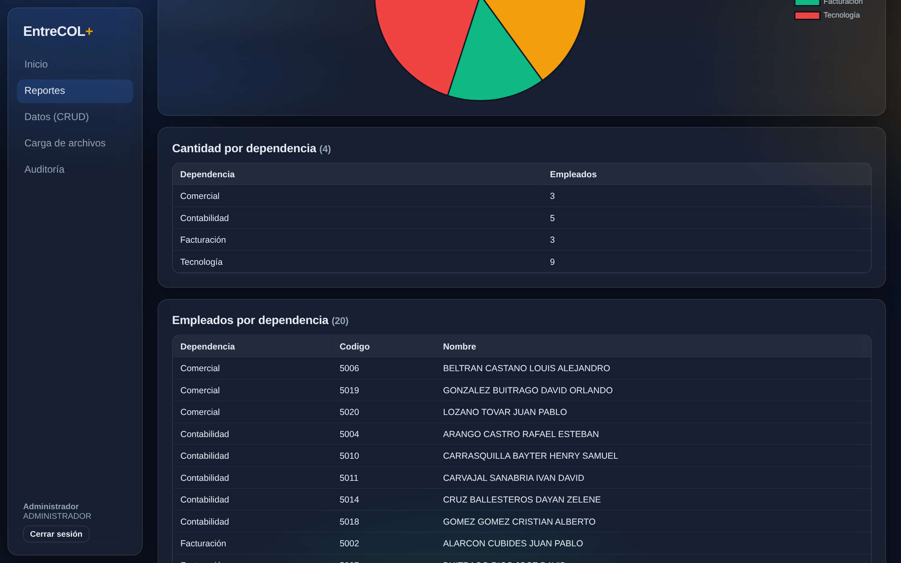
Nota: Captura del sistema EntreCOL+.

## Reporte de Información Personal

Elija el empleado en la lista desplegable, que muestra el código y el nombre, y presione Generar. El reporte presenta el nombre completo, el código, la dependencia, el cargo, la fecha de ingreso en formato DD/MM/AAAA, la EPS, la ARL, el fondo de pensión, el aporte a pensión (4 % del salario) y el salario. Debajo aparecen las liquidaciones del empleado y la discriminación de sus novedades, como muestra la Figura 7.

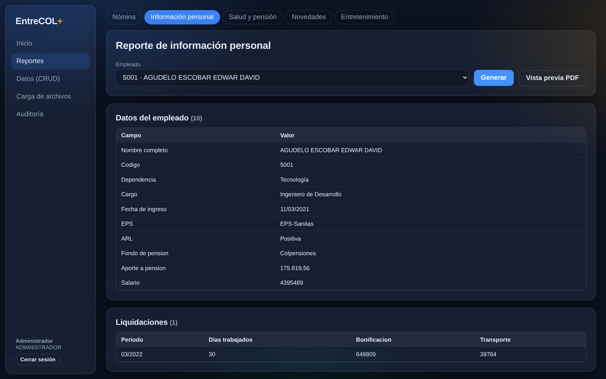
Nota: Captura del sistema EntreCOL+.

## Reporte de Salud y Pensión

Seleccione el orden de los nombres y presione Generar. La Figura 8 muestra el gráfico de frecuencia de empleados por EPS y el comienzo del gráfico de barras comparativas por EPS y dependencia. El reporte continúa con la cantidad y la lista de empleados por cargo y EPS y repite las mismas secciones para los fondos de pensión.

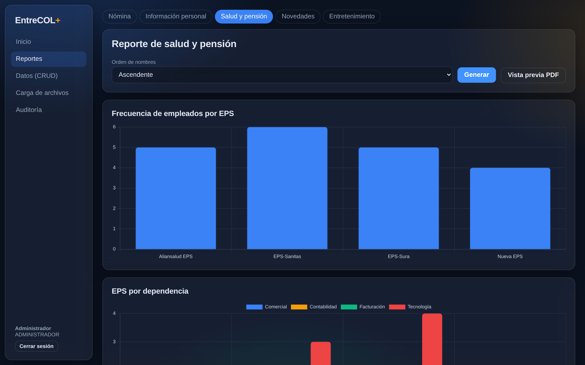
Nota: Captura del sistema EntreCOL+.

## Reporte de Novedades

Escriba el mes inicial y el mes final en formato MM/AAAA (por ejemplo, 01/2022 y 12/2022), elija el orden y presione Generar. Una novedad aparece en el reporte si alguno de sus días cae dentro del rango. La Figura 9 muestra la cantidad de empleados con novedades, la lista con el tipo (incapacidad o vacaciones), las fechas de inicio y fin y los días, y el gráfico por dependencia. Al final aparecen las cantidades por dependencia y por cargo.

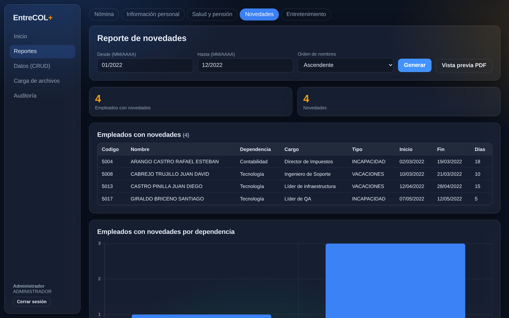
Nota: Captura del sistema EntreCOL+.

## Reporte de la Base de Entretenimiento

Este reporte tiene cinco parámetros: el año inicial y el año final (filtran películas y libros), el valor de N para el Top N de libros, la cantidad de géneros para la lista de películas con N géneros y el orden de los títulos. La Figura 10 muestra los indicadores y el gráfico de frecuencia de películas por género. Debajo aparecen las películas por género, el Top N de libros con mejor calificación, el Top 5 de libros con mejor y peor calificación por año, las películas con N géneros y el gráfico de frecuencia de libros por año de publicación.

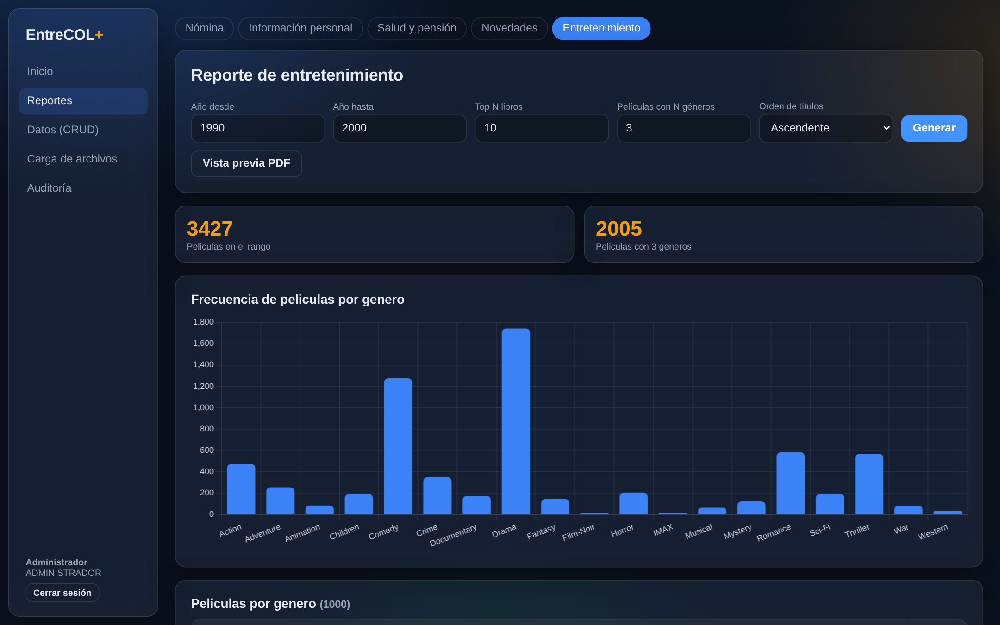
Nota: Captura del sistema EntreCOL+.

El Top N ordena primero por calificación y, en caso de empate, por la cantidad de calificaciones recibidas, para que un libro con una sola calificación no supere a otro calificado por miles de lectores.

## Vista Previa, Impresión y Descarga en PDF

En cualquier reporte, presione Vista previa PDF. El sistema genera el documento en el servidor y lo muestra dentro de la página, como en la Figura 11. El PDF incluye el título del reporte, los parámetros usados, los indicadores, las tablas y los gráficos, y al pie de cada página el usuario que lo generó, la fecha y el número de página. Use Imprimir para enviarlo a la impresora, Descargar para guardarlo o Cerrar para volver al reporte. Cada reporte generado, en pantalla o en PDF, queda registrado en la auditoría.

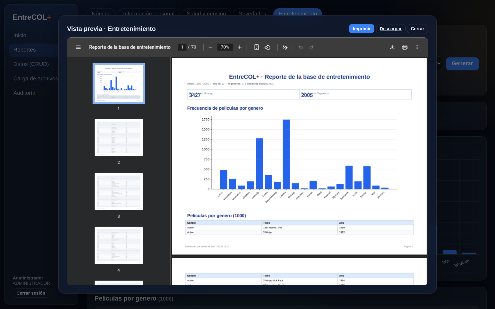
Nota: Captura del sistema EntreCOL+.

# Administración de Datos (CRUD)

Esta opción solo está disponible para el administrador. Permite consultar, crear, modificar y eliminar los registros de todas las entidades del sistema, agrupadas en tres módulos: Nómina (dependencias, cargos, EPS, ARL, fondos de pensión, tipos de novedad, empleados, periodos, liquidaciones mensuales, novedades y parámetros), Entretenimiento (películas, géneros, géneros por película, libros, autores, editoriales, idiomas y series) y Seguridad (usuarios y roles).

## Consultar Registros

En el menú lateral, elija Datos (CRUD) y seleccione la entidad en la lista Entidad. La tabla muestra 25 registros por página; use las flechas de la parte inferior para avanzar o retroceder, y el texto central indica la página actual y el total de registros. La Figura 12 muestra la lista de empleados.

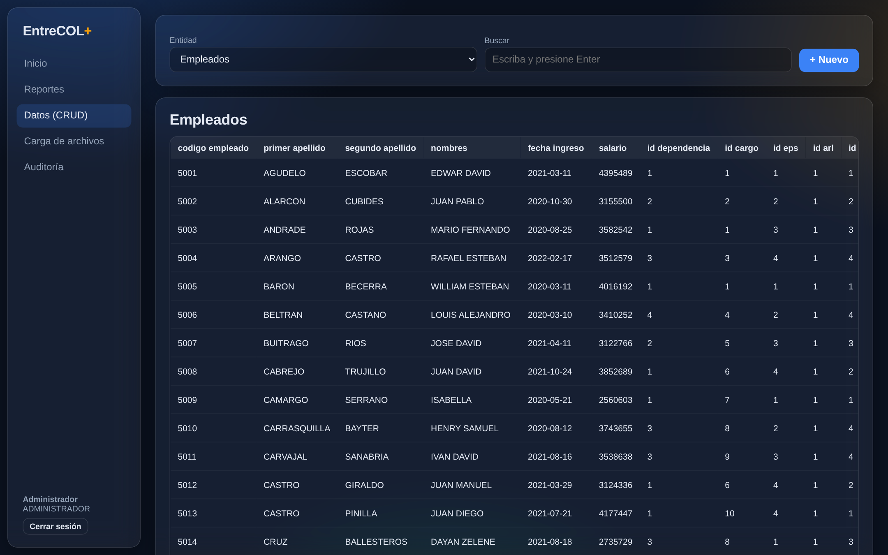
Nota: Captura del sistema EntreCOL+.

Para buscar, escriba una parte del texto en el campo Buscar y presione Enter. La búsqueda se hace sobre los campos principales de cada entidad, por ejemplo el nombre y el código del empleado, o el título y el ISBN del libro. La Figura 13 muestra la búsqueda de "Harry Potter" en los libros.

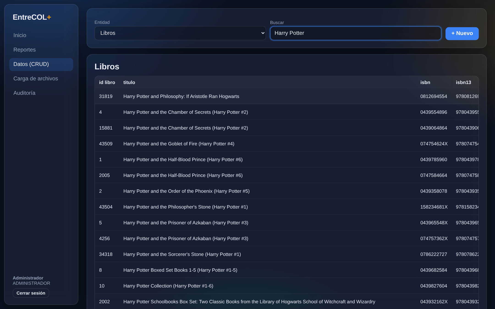
Nota: Captura del sistema EntreCOL+.

## Crear y Modificar Registros

Para crear un registro, presione + Nuevo; para modificarlo, presione Editar en su fila. Se abre un formulario como el de la Figura 14. Los campos que se relacionan con otra entidad (por ejemplo, la dependencia o la EPS de un empleado) se eligen en una lista desplegable, para evitar errores de escritura. Las fechas se escogen en un calendario. La llave de un registro no se puede cambiar al editarlo. Complete los campos y presione Guardar, o Cancelar para salir sin cambios.

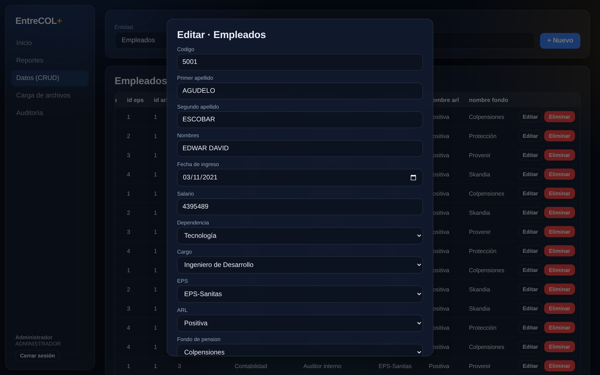
Nota: Captura del sistema EntreCOL+.

Al crear un usuario del sistema, la contraseña debe tener al menos ocho caracteres y se guarda cifrada. Al editar un usuario, deje la contraseña vacía si no desea cambiarla; desmarque Activo para impedir que ese usuario ingrese sin borrarlo. Un administrador no puede eliminar su propio usuario.

## Eliminar Registros

Presione Eliminar en la fila del registro y confirme la acción. La eliminación queda registrada en la auditoría con los valores que tenía el registro. Algunos registros no se pueden eliminar mientras otros dependan de ellos, por ejemplo una dependencia que todavía tiene empleados; en ese caso el sistema muestra un mensaje y no borra nada. Al eliminar una liquidación se eliminan también sus novedades, y al eliminar una película o un libro se eliminan sus relaciones con géneros, autores y series.

## Mensajes de Validación

Cuando un dato no cumple las reglas de la base de datos, el formulario muestra un mensaje en rojo. La Tabla 4 explica los mensajes posibles.

Tabla: Mensajes del Módulo de Datos y su Significado
| Mensaje | Causa | Qué hacer |
|---|---|---|
| El campo es obligatorio | Un campo requerido quedó vacío | Complete el campo |
| Valor inválido para el campo | El número o la fecha no tiene un formato válido | Corrija el valor |
| Ya existe un registro con ese valor único | El nombre, código o ISBN ya existe | Use otro valor o edite el registro existente |
| No se puede eliminar: otros registros dependen de este | El registro está en uso (por ejemplo, un cargo asignado a empleados) | Reasigne o elimine primero los registros que dependen de él |
| El valor seleccionado en una relación no existe | La opción elegida fue eliminada por otro usuario | Recargue la página y elija otra opción |
| Un valor no cumple las restricciones de la tabla | Por ejemplo, salario cero, mes mayor que 12 o fecha final anterior a la inicial | Corrija el valor según la regla |
Nota: Elaboración propia.

# Carga de Archivos

Esta opción solo está disponible para el administrador y permite cargar por primera vez, o volver a cargar, los archivos de la empresa. La Figura 15 muestra la pantalla, con un formulario para cada tipo de archivo.

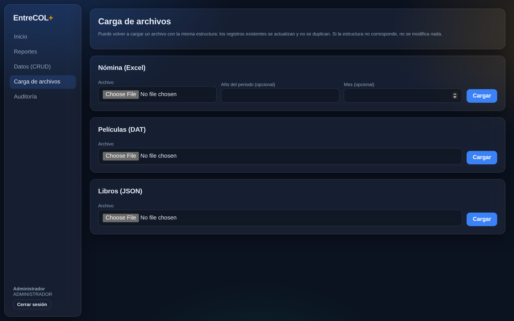
Nota: Captura del sistema EntreCOL+.

## Formato de los Archivos

Los archivos deben conservar la estructura original que entregó la empresa. La Tabla 5 la resume.

Tabla: Formato Esperado de Cada Archivo
| Archivo | Extensión | Estructura |
|---|---|---|
| Nómina | .xlsx | Primera hoja con los empleados (CÓDIGO, NOMBRE DEL EMPLEADO, DEPENDENCIA, CARGO, FECHA INGRESO, EPS, ARL, PENSIÓN y SUELDO). Cada hoja siguiente contiene la liquidación de un mes, con las columnas de días trabajados, novedades de incapacidad y vacaciones con sus fechas, bonificación y transporte |
| Películas | .dat o .txt | Una película por línea con tres campos separados por "::": identificador, título seguido del año entre paréntesis y géneros separados por barra vertical |
| Libros | .json | Lista de objetos con los campos bookID, title, authors, average_rating, isbn, isbn13, language_code, num_pages, ratings_count, text_reviews_count, publication_date y publisher |
Nota: El tamaño máximo de cada archivo es 50 MB.

## Pasos para Cargar un Archivo

1. En el menú lateral, elija Carga de archivos.
2. En el formulario del tipo de archivo, presione el botón de selección y elija el archivo.
3. Solo para la nómina: si la hoja de liquidación no indica el mes en su nombre, escriba el año y el mes del periodo. Si los deja vacíos, el sistema toma el mes de la novedad más antigua y lo informa como aviso.
4. Presione Cargar y espere; el botón muestra "Cargando…" mientras se procesa. Los archivos de libros y películas pueden tardar algunos segundos.

Al terminar aparece un resumen con cinco indicadores, que explica la Tabla 6, seguido de los avisos y de la lista de registros rechazados con su motivo.

Tabla: Indicadores del Resumen de Carga
| Indicador | Significado |
|---|---|
| Leídos | Registros encontrados en el archivo |
| Insertados | Registros nuevos guardados en la base |
| Actualizados | Registros que ya existían y cambiaron |
| Sin cambios | Registros que ya existían con los mismos valores |
| Rechazados | Registros con datos inválidos que no se cargaron; cada uno aparece con su motivo |
Nota: Elaboración propia.

## Recarga y Validaciones

Puede volver a cargar un archivo con la misma estructura en cualquier momento. Los registros existentes se actualizan y no se duplican. Si el archivo no tiene la estructura esperada (por ejemplo, faltan columnas o no es un JSON válido), el sistema rechaza la carga completa, muestra el motivo y no modifica ningún dato. Si solo algunos registros son inválidos, se cargan los demás y los inválidos se listan con su motivo. El sistema corrige automáticamente algunos problemas conocidos de los archivos, como los libros cuyos campos llegan desplazados, y los informa en la sección Avisos.

# Auditoría

Esta opción solo está disponible para el administrador. Permite consultar todo lo que ha ocurrido en el sistema. Indique la fecha inicial y final (si las deja vacías, se toman los últimos 30 días) y, si lo desea, un usuario, y presione Generar. La Figura 16 muestra el resultado.

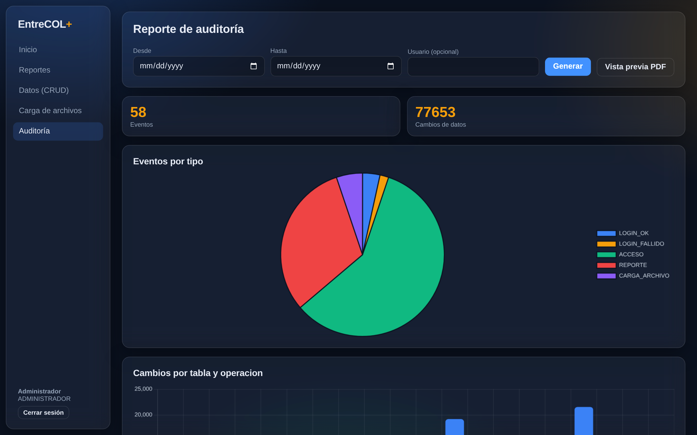
Nota: Captura del sistema EntreCOL+.

El reporte tiene dos partes:

- **Eventos:** inicios de sesión exitosos y fallidos, cierres de sesión, accesos a la API, reportes generados y cargas de archivos, con la fecha, el usuario, el detalle y la dirección IP.
- **Cambios de datos:** cada inserción, modificación y eliminación hecha en cualquier tabla, con la fecha, el usuario, la tabla, la operación, la llave del registro y sus valores antes y después del cambio. Estos cambios los registra la propia base de datos, de modo que quedan aunque se hagan fuera de la aplicación.

Los gráficos muestran los eventos por tipo y los cambios por tabla y operación. El reporte también tiene vista previa en PDF. Nadie, ni siquiera el administrador, puede modificar ni borrar la auditoría desde el sistema.

# Documentación de la API

Para el personal técnico, el sistema publica la documentación interactiva de su interfaz de programación en http://localhost:8000/docs, que muestra la Figura 17. Allí se listan todas las rutas de autenticación, CRUD, carga y reportes, con sus parámetros.

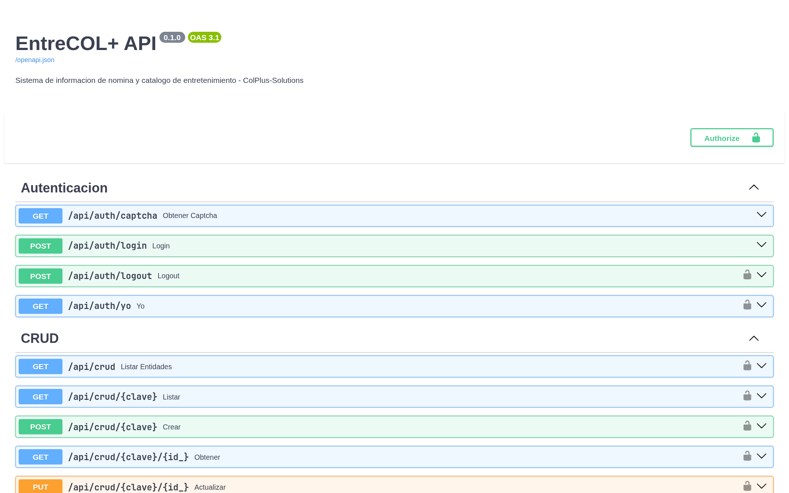
Nota: Captura del sistema EntreCOL+.

# Solución de Problemas

La Tabla 7 reúne los problemas más frecuentes y su solución.

Tabla: Problemas Frecuentes y su Solución
| Problema | Solución |
|---|---|
| "No hay conexión con la API" en la pantalla de ingreso | El servidor no está en marcha; pida al área de tecnología que lo inicie |
| "El captcha es incorrecto o expiró" | Escriba el texto de la nueva imagen; si tardó más de cinco minutos, el captcha venció |
| "Usuario o contraseña incorrectos" | Verifique los datos y que la tecla Bloq Mayús esté desactivada; si el usuario fue desactivado, contacte al administrador |
| "La sesión expiró" | Inicie sesión de nuevo; la sesión dura 60 minutos |
| "Solo el administrador puede realizar esta acción" | Su rol es Consulta; solicite la acción a un administrador |
| "Fecha inválida, use MM/AAAA" en el reporte de novedades | Escriba el mes con dos dígitos y el año con cuatro, por ejemplo 03/2022 |
| "Estructura inválida" al cargar un archivo | El archivo no tiene las columnas o campos esperados; revise la Tabla 5 |
| "Extensión no permitida" | Verifique que el archivo sea .xlsx, .dat, .txt o .json según el formulario |
| La vista previa del PDF no aparece o se ve en blanco | Espere unos segundos (los reportes grandes tardan más), recargue la página o use el botón Descargar |
Nota: Elaboración propia.

# Glosario

La Tabla 8 define los términos usados en el sistema y en este manual.

Tabla: Glosario de Términos
| Término | Definición |
|---|---|
| ARL | Administradora de riesgos laborales a la que está afiliado el empleado |
| Auditoría | Registro de quién hizo cada acción en el sistema, cuándo y qué cambió |
| Captcha | Prueba que pide escribir el texto de una imagen para comprobar que quien ingresa es una persona |
| CRUD | Crear, leer, actualizar y eliminar registros |
| EPS | Entidad promotora de salud a la que está afiliado el empleado |
| ETL | Proceso de extracción, transformación y carga de los archivos a la base de datos |
| Liquidación mensual | Registro de los días trabajados, la bonificación y el transporte de un empleado en un periodo |
| Novedad | Incapacidad o vacaciones de un empleado dentro de una liquidación |
| Periodo | Mes y año de una liquidación de nómina |
| Rol | Conjunto de permisos de un usuario: Administrador o Consulta |
| Token de sesión | Credencial temporal que el sistema entrega al iniciar sesión y que vence a los 60 minutos |
Nota: Elaboración propia.
